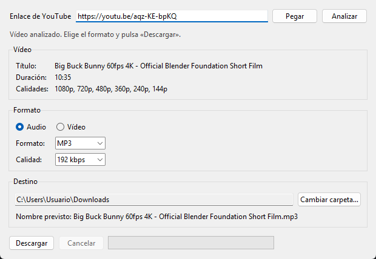

<div align="center">


# Pescaclip

**Pega un enlace de YouTube y guarda el vídeo o su audio en el formato que quieras.**
Aplicación de escritorio para Windows 11, en español y sin instalación.

[](https://github.com/Hash-0x/PescaClip/releases/latest/download/Pescaclip.exe)


[](https://github.com/Hash-0x/PescaClip/releases)



</div>

> [!IMPORTANT]
> Úsalo solo con **contenido propio o con permiso** del titular. Pescaclip no usa cuentas, servidores ni telemetría, y no elude DRM ni restricciones de acceso.

## ✨ Qué hace

| | |
|---|---|
| 🔗 **Cualquier enlace de vídeo** | Admite enlaces normales, `youtu.be` y Shorts. Si el enlace incluye una lista, descarga solo el vídeo indicado. |
| 🎧 **Audio o vídeo** | Puedes guardar solo el audio o el vídeo completo, en el formato que elijas. |
| 🎯 **Calidad real** | Muestra las resoluciones disponibles, hasta 1080p, sin reescalar. Copia las pistas compatibles en lugar de recodificarlas. |
| 📊 **Progreso claro** | Muestra las fases *Descargando → Convirtiendo → Completado* y permite **Cancelar** en cualquier momento. |
| 🛡️ **No pisa nada** | Si ya existe un archivo con el mismo nombre, crea `Título (1).mp3`. Al cancelar no deja archivos a medias. |
| 📂 **Recuerda tu carpeta** | Usa Descargas por defecto, guarda la última carpeta elegida y te deja reproducir el archivo o abrir su carpeta al terminar. |

## 🎚️ Formatos

| Modo | Formato | Calidad | Notas |
|---|---|---|---|
| 🎧 Audio | **MP3** | 128 · **192** · 320 kbps | Compatible con todo |
| 🎧 Audio | **M4A** | La original | Copia el AAC de YouTube sin pérdida extra ⭐ |
| 🎧 Audio | **WAV** | Sin compresión | Archivos grandes, para edición |
| 🎬 Vídeo | **MP4** | Hasta 1080p | H.264 + AAC, se reproduce en cualquier sitio |
| 🎬 Vídeo | **WebM** | Hasta 1080p | VP9/AV1 + Opus, normalmente sin recodificar |

> [!TIP]
> El audio de YouTube ronda los 128–160 kbps. Para la máxima calidad, elige **M4A**. Un MP3 de 320 kbps pesa más, pero no suena mejor.

## 🚀 Empezar

### Opción A: usar el .exe (recomendado)

1. Descarga **[Pescaclip.exe](https://github.com/Hash-0x/PescaClip/releases/latest/download/Pescaclip.exe)**. Ya incluye FFmpeg, así que no tienes que instalar nada.
2. Ábrelo con doble clic. La primera vez tarda unos segundos porque se descomprime.
3. Pega el enlace → **Analizar** → elige el formato → **Descargar**.

> [!NOTE]
> Windows SmartScreen puede avisar porque el .exe no está firmado. Pulsa **Más información → Ejecutar de todas formas**.

### Opción B: ejecutar desde el código

```powershell
winget install Python.Python.3.13
winget install Gyan.FFmpeg
git clone https://github.com/Hash-0x/PescaClip.git
```

Después haz doble clic en **`Abrir Pescaclip.bat`**. La primera vez crea un entorno `.venv` e instala [`yt-dlp`](https://github.com/yt-dlp/yt-dlp).

## 🛠️ Para desarrolladores

```
PescaClip/
├── app.py               Interfaz Tkinter (los hilos solo hablan con ella mediante una cola)
├── core.py              Enlaces, análisis, elección de formatos, descarga, FFmpeg y cancelación
├── test_local.py        Pruebas sin Internet con clips generados por FFmpeg
├── build_exe.bat        Genera dist\Pescaclip.exe con PyInstaller (FFmpeg incluido)
└── Abrir Pescaclip.bat  Iniciador con doble clic
```

- **Pruebas:** `.venv\Scripts\python test_local.py` comprueba con FFprobe todos los formatos, la cancelación durante la descarga y durante la conversión, los nombres repetidos y las carpetas no válidas.
- **Compilar el .exe:** `build_exe.bat`. Necesita FFmpeg instalado, porque copia sus binarios dentro del .exe.
- **Recomendado:** tener [Node.js](https://nodejs.org) o [Deno](https://deno.com). yt-dlp los usa para resolver los desafíos de YouTube; sin ellos puede haber menos calidades disponibles.

## ❓ Problemas frecuentes

<details>
<summary><b>Error 403 o «YouTube pide verificar que no eres un bot»</b></summary>

YouTube cambia a menudo y hay que actualizar yt-dlp:

```powershell
.venv\Scripts\python -m pip install -U "yt-dlp[default]"
```

Si usas el .exe, descarga la última release o vuelve a generarlo con `build_exe.bat`.
</details>

<details>
<summary><b>«El vídeo tiene restricción de edad», «es privado» o «es solo para miembros»</b></summary>

Pescaclip no inicia sesión en YouTube, así que esos vídeos no se pueden descargar. Es intencionado.
</details>

<details>
<summary><b>«No se encuentra FFmpeg» (solo al ejecutar desde el código)</b></summary>

Instálalo con `winget install Gyan.FFmpeg` y vuelve a abrir la aplicación. También puedes copiar `ffmpeg.exe` y `ffprobe.exe` junto a `app.py`.
</details>

## 📄 Créditos

- [yt-dlp](https://github.com/yt-dlp/yt-dlp) obtiene el contenido.
- [FFmpeg](https://ffmpeg.org) convierte y comprueba los archivos. El .exe incluye la compilación de [gyan.dev](https://www.gyan.dev/ffmpeg/builds/), con licencia GPL.
- La captura usa *Big Buck Bunny*, © Blender Foundation, con licencia [CC BY 3.0](https://creativecommons.org/licenses/by/3.0/).
